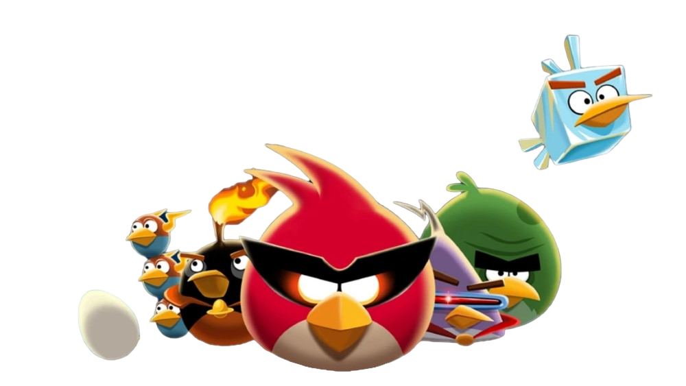
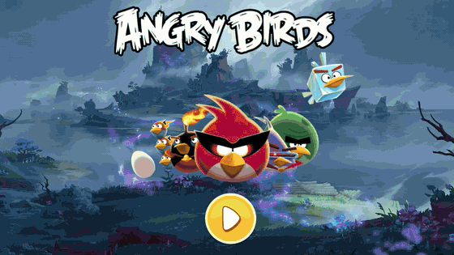
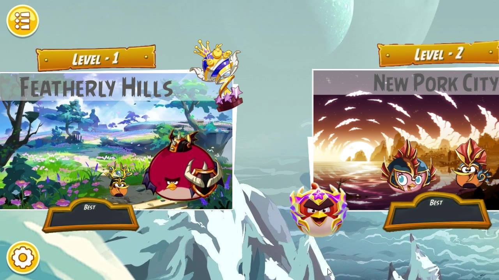
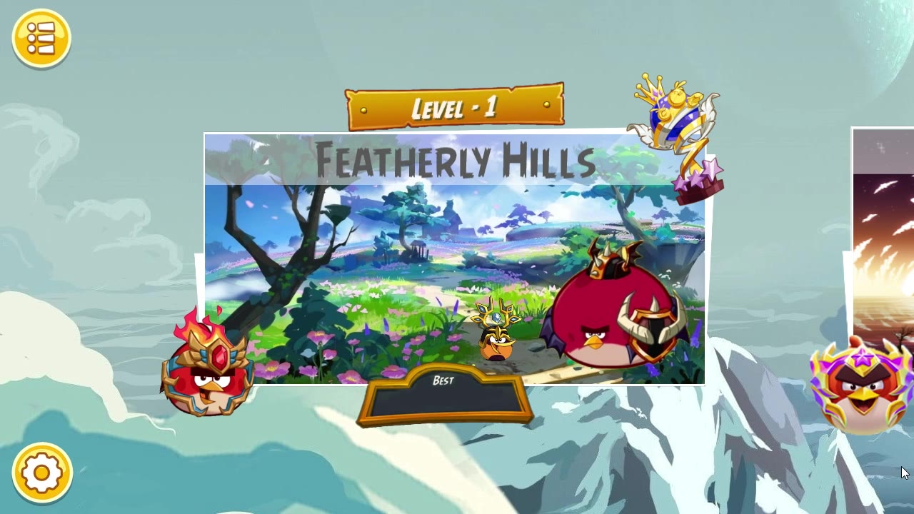
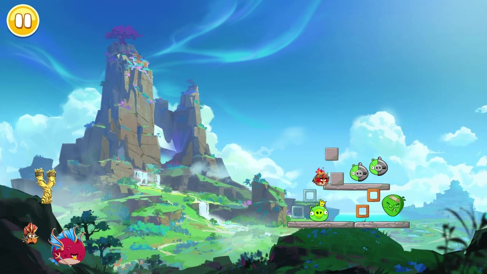
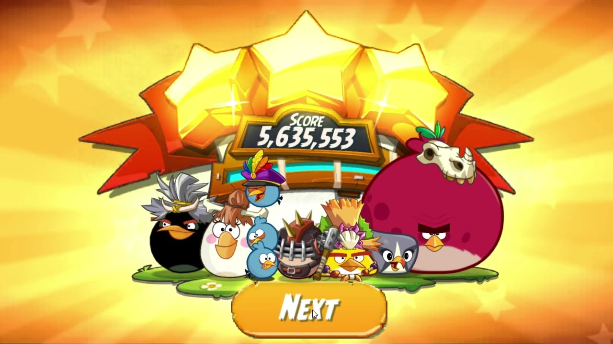

<div align="center">



# Angry Birds Ultra

**A physics-based Angry Birds clone for desktop, built with libGDX and Box2D.**




</div>

## ✨ Features

- 🎯 **Drag-and-release slingshot** with real Box2D physics
- 🗺️ **Three themed levels**: Featherly Hills, New Pork City and Eggchanted Woods
- 🐦 **Five birds**: Red, Chuck, Bomb, Bubbles and Terence
- 🐷 **Three pigs** (Chef, King and Space) plus wood, glass and stone blocks
- 🏆 **Scoring**, plus win and lose screens
- ⏸️ **Pause menu** to resume, restart or exit

## 📸 Screenshots

<table>
  <tr>
    <td></td>
    <td></td>
  </tr>
  <tr>
    <td align="center"><b>Level select</b></td>
    <td align="center"><b>Gameplay</b></td>
  </tr>
  <tr>
    <td></td>
    <td></td>
  </tr>
  <tr>
    <td align="center"><b>Pause menu</b></td>
    <td align="center"><b>Victory</b></td>
  </tr>
</table>

## 🚀 Getting started

You need **JDK 11 or newer**. The Gradle wrapper is included.

```bash
git clone https://github.com/SnehilK3372/Angry_Birds.git
cd Angry_Birds
./gradlew lwjgl3:run        # Windows: gradlew.bat lwjgl3:run
```

You can also run `Lwjgl3Launcher` directly from your IDE. To build a runnable jar, use `./gradlew lwjgl3:jar`; it is written to `lwjgl3/build/libs`.

## 🎮 How to play

1. Press **Play** on the title screen.
2. Scroll through the level cards and pick a level.
3. **Drag** the bird back from the slingshot and **release** to launch.
4. Knock out every pig to win. Use the ⏸️ button to pause, restart or exit.

## 🗂️ Project structure

```text
core/     Game logic shared by all platforms (screens, levels, birds, pigs, blocks)
lwjgl3/   Desktop launcher (LWJGL3)
assets/   Sprites, backgrounds, fonts and UI
```

## 🙏 Credits

Built with [libGDX](https://libgdx.com/), generated with [gdx-liftoff](https://github.com/libgdx/gdx-liftoff).
Art and sprites come from the [Angry Birds Wiki](https://angrybirds.fandom.com/), [The Spriters Resource](https://www.spriters-resource.com/mobile/angrybirds2/), [Sprite Database](https://spritedatabase.net/system/mobile), [Wallpaper Flare](https://www.wallpaperflare.com/) and [PeakPX](https://www.peakpx.com/).

<sub>Angry Birds is a trademark of Rovio Entertainment. This is a non-commercial fan project made for learning.</sub>
